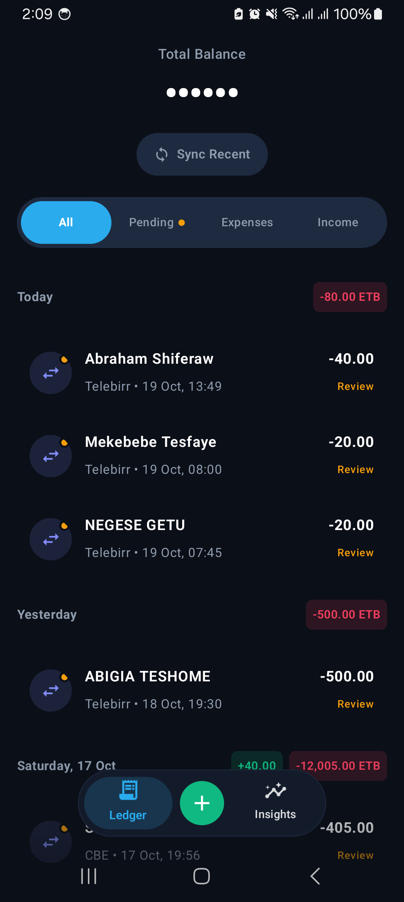
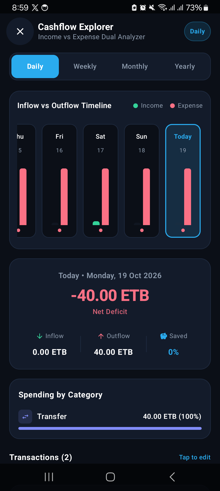
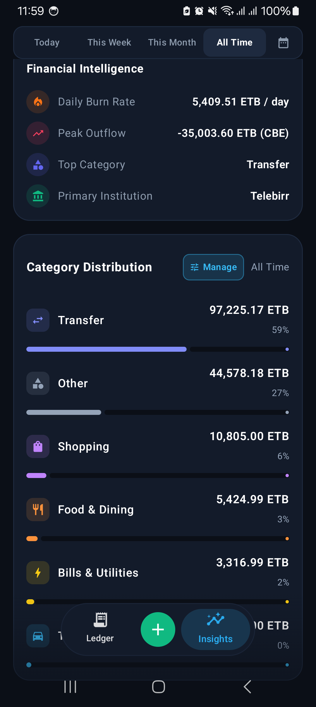
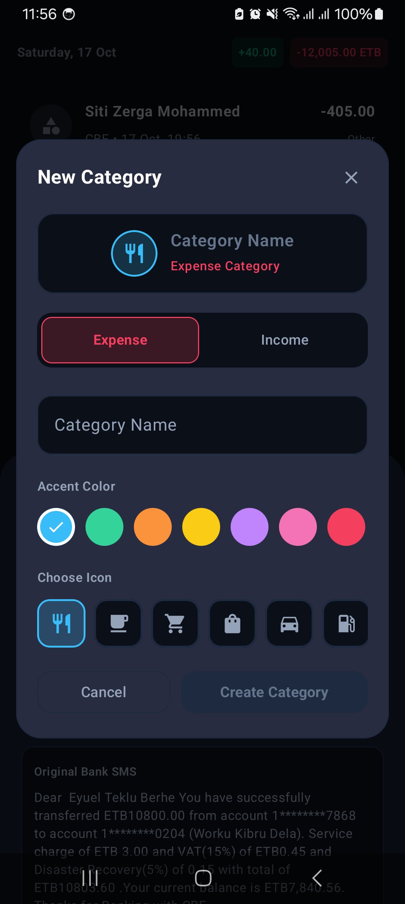
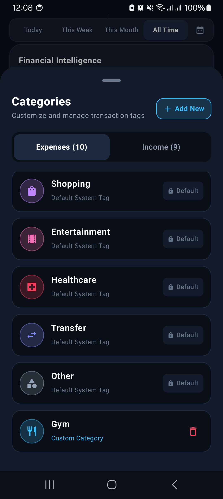

# SmartSpend 💳

<p align="center">
  
</p>

<p align="center">
  <b>A sleek, private, offline-first personal finance and automated banking expense tracker for Android.</b>
</p>

<p align="center">
  <a href="https://github.com/Eyeyuel/SmartSpend/releases/latest"></a>
  <a href="https://kotlinlang.org"></a>
  <a href="https://developer.android.com/jetpack/compose"></a>
  <a href="#"></a>
  <a href="#"></a>
</p>

---

## 📥 Download the App

Download the latest universally compatible release APK directly to your Android device:

[-0088cc?style=for-the-badge&logo=googleplay&logoColor=white)](https://github.com/Eyeyuel/SmartSpend/releases/download/v1.0.0/SmartSpend-v1.0.0.apk)

### Installation Guide:
1. Tap the **Download APK** button above on your Android phone (or download from the [Releases](https://github.com/Eyeyuel/SmartSpend/releases) page).
2. When prompted by your browser, tap **Download anyway**.
3. Open the downloaded file (`SmartSpend-v1.0.0.apk`).
4. If asked, toggle **Allow installation from this source**.
5. Tap **Install** and open SmartSpend!

---

## 🔒 100% Private, Local-First, Zero Ads

> **Your financial privacy is non-negotiable.**
>
> - **Zero Cloud Uploads**: SmartSpend has **no backend servers**, **no user accounts**, and **no cloud sync**. Everything lives solely in your phone's encrypted SQLite/Room storage.
> - **Zero Analytics or Trackers**: No third-party SDKs, no tracking beacons, and no telemetry.
> - **Zero Advertisements**: Clean, uncompromised user experience without ads or monetization bloat.
> - **On-Device SMS Parsing**: Banking SMS messages are parsed entirely offline in local memory inside the app sandbox.

---

## 📱 Screenshots

<table align="center">
  <tr>
    <td align="center" width="20%"><b>Ledger & Stream</b></td>
    <td align="center" width="20%"><b>Cashflow Explorer</b></td>
    <td align="center" width="20%"><b>Financial Intelligence</b></td>
    <td align="center" width="20%"><b>Create Custom Category</b></td>
    <td align="center" width="20%"><b>Category Management</b></td>
  </tr>
  <tr>
    <td valign="top"></td>
    <td valign="top"></td>
    <td valign="top"></td>
    <td valign="top"></td>
    <td valign="top"></td>
  </tr>
</table>

---

## ✨ Features

- **Automated Bank SMS Ingestion**:
  - Automatically intercepts and categorizes incoming SMS notifications in real-time from major Ethiopian banks (Commercial Bank of Ethiopia, Telebirr, Awash Bank, Dashen Bank, Nib International Bank, Bank of Abyssinia, etc.).
  - Extracts amounts, balances, debits, credits, reference IDs, and counterparties seamlessly.
- **Historical SMS Import**:
  - Ingest past transaction history from your SMS inbox with a single tap of the **Sync Recent** button.
- **Physical Cash Tracking**:
  - Dedicated bottom sheet for logging manual cash expenses and income with quick amount chips (`+50`, `+100`, `+200`, `+500`), date selection, and notes.
- **Cashflow Explorer (Dual Inflow vs Outflow)**:
  - Visual financial intelligence comparing earnings vs spending across **Daily**, **Weekly**, **Monthly**, and **Yearly** views with interactive drill-down.
- **Custom Categories & Personalization**:
  - Create and manage custom categories on the fly with a 12-color fintech palette and 26 Material icons.
  - Safe category deletion: automatically reassigns existing transactions to "Other" with zero data loss.
- **One-Click CSV Export**:
  - Export full transaction history as a standard `.csv` file via Android's native share sheet for easy spreadsheets or accounting.
- **Universal Device Compatibility**:
  - Built for all screen aspect ratios, responsive on Android 8.0 (API 26) through Android 15 (API 35), and supporting both gesture navigation and 3-button system bars.

---

## 🧠 How the Logic Works

```
                                 [ Incoming SMS ]
                                        │
                                        ▼
                               ┌──────────────────┐
                               │   SmsReceiver    │ (BroadcastReceiver)
                               └────────┬─────────┘
                                        │
                                        ▼
                            ┌────────────────────────┐
                            │   BankParserRegistry   │
                            └───────────┬────────────┘
                                        │
             ┌──────────────────────────┼──────────────────────────┐
             ▼                          ▼                          ▼
      [ CbeParser ]             [ TelebirrParser ]          [ GenericParser ]
             │                          │                          │
             └──────────────────────────┼──────────────────────────┘
                                        │ (Normalized ParsedTransaction)
                                        ▼
                            ┌────────────────────────┐
                            │ TransactionRepository  │
                            └───────────┬────────────┘
                                        │
                                        ▼
                            ┌────────────────────────┐
                            │    Room Database       │ (Local Encrypted SQLite)
                            └───────────┬────────────┘
                                        │ (StateFlow / Coroutines)
                                        ▼
                            ┌────────────────────────┐
                            │  ViewModel & Compose   │ (Telegram Dark Fintech UI)
                            └────────────────────────┘
```

1. **Ingestion Layer**:
   - `SmsReceiver` catches `SMS_RECEIVED_ACTION` broadcast intents. It groups multi-part SMS messages by originating sender so split bank alerts are reassembled before parsing.
2. **Parsing & Normalization Engine**:
   - `BankParserRegistry` routes the text to bank-specific parsers (`CbeParser`, `TelebirrParser`, `NibParser`, `AbyssiniaParser`, or `GenericBankParser`).
   - Regex patterns extract transaction amount, currency (`ETB`), account balances, transaction type (`DEBIT` vs `CREDIT`), counterparty, and reference code.
3. **Local Database & Reactive Storage**:
   - Verified data is committed to the local Room database (`transactions` and `user_categories` tables).
   - Queries emit reactive Kotlin `StateFlow` streams that automatically update dashboard balances and date-grouped transaction lists without manual polling.
4. **UI Design System**:
   - Built entirely in Jetpack Compose using modern dark fintech tokens (deep midnight `#0B0F17`, electric cyan `#2AABEE`, emerald `#10B981`, and rose `#F43F5E`) with smooth spring animations.

---

## 🛠️ Clone & Build Locally

### Prerequisites:
- **Android Studio** Ladybug (2024.2+) or newer
- **JDK 17**
- **Android SDK** with build-tools `35.0.0`
- Minimum Android device or emulator running **Android 8.0 (API 26)+**

### 1. Clone the Repository
```bash
git clone https://github.com/Eyeyuel/SmartSpend.git
cd SmartSpend
```

### 2. Build Debug APK
```bash
./gradlew assembleDebug
```
The debug APK will be generated at:
`app/build/outputs/apk/debug/app-debug.apk`

### 3. Build Signed Release APK
```bash
./gradlew assembleRelease
```
The universal release APK will be generated at:
`app/build/outputs/apk/release/app-release.apk`

### 4. Run Unit Tests
```bash
./gradlew test
```

---

## 🛡️ Required Permissions Explained

| Permission | Purpose |
|---|---|
| `android.permission.RECEIVE_SMS` | Intercept incoming bank notification alerts in real-time. |
| `android.permission.READ_SMS` | Scan historical banking alerts from inbox upon user request. |
| `android.permission.POST_NOTIFICATIONS` | Deliver instant transaction review alerts (Android 13+). |

*Note: SmartSpend never requests internet access (`android.permission.INTERNET` is not included in the manifest). The app cannot communicate with any external server by design.*

---

## 📄 License

This project is licensed under the [MIT License](LICENSE).
